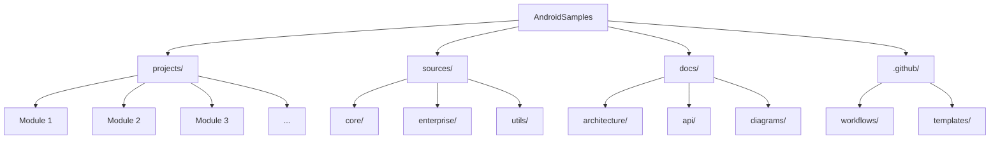
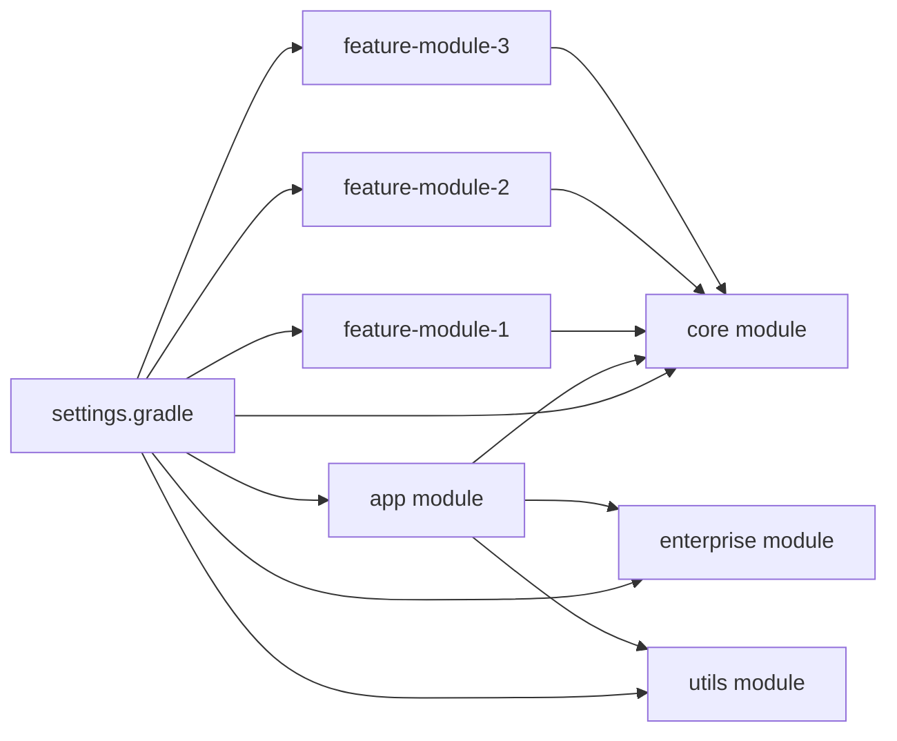
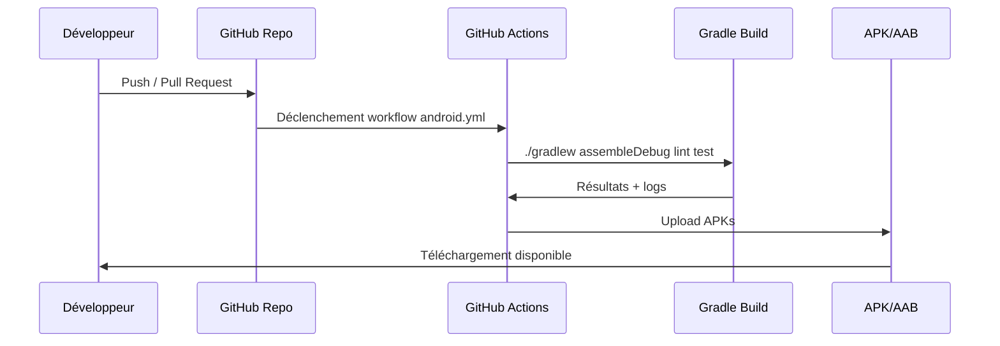
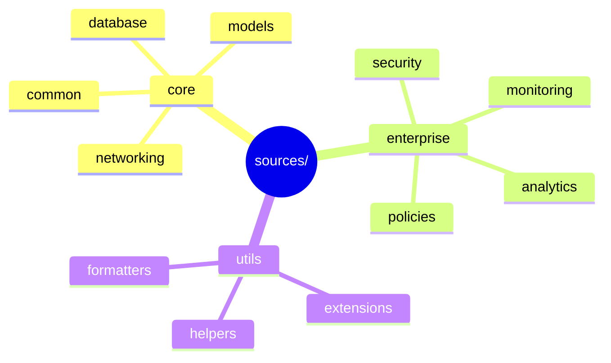
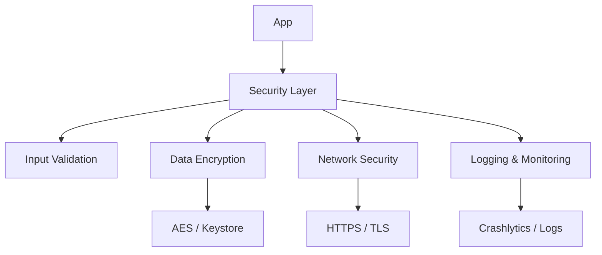
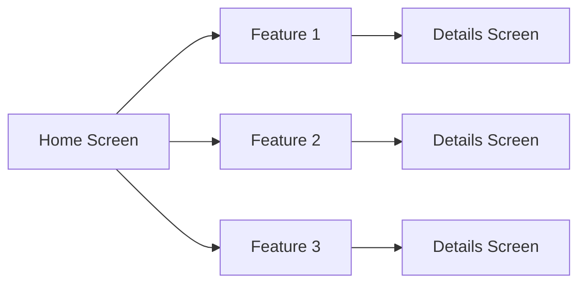
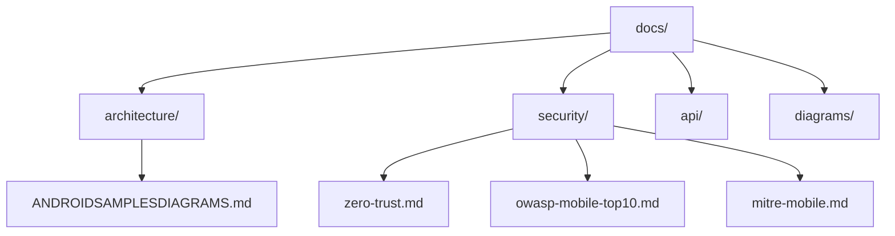

###### architecture.md >> markdown
# AndroidSamples
- *multi‑modules professionnel*.

---

🎯 Objectif : créer un fichier unique contenant tous les diagrammes utiles

Nom du fichier recommandé :

###### ✅ AndroidSamples/docs/architecture.md

### 📄 Contenu du fichier :
- 📐 AndroidSamples — Diagrammes d’Architecture (Mermaid)
- Version STABLE — Documentation officielle

Ce document regroupe les diagrammes essentiels pour comprendre la structure, les modules, les flux et l’architecture du dépôt AndroidSamples

---

### 1. 🧩 Structure générale du dépôt

---

### 2. 🏗️ Architecture Android multi‑modules

---

### 3. 🔧 Pipeline CI/CD GitHub Actions

---

### 4. 🧱 Architecture logique interne (sources/)

---

### 5. 🔐 Sécurité — Vue simplifiée

---

### 6. 🧭 Navigation simplifiée de l’application

---

### 7. 🗂️ Organisation recommandée des documents

---

📌 Conclusion

Ce fichier regroupe :
- la structure du dépôt  
- l’architecture Android multi‑modules  
- le pipeline CI/CD  
- la logique interne des modules  
- la sécurité  
- la navigation  
- l’organisation documentaire  

Il constitue la base officielle de la documentation visuelle de ton projet AndroidSamples.

